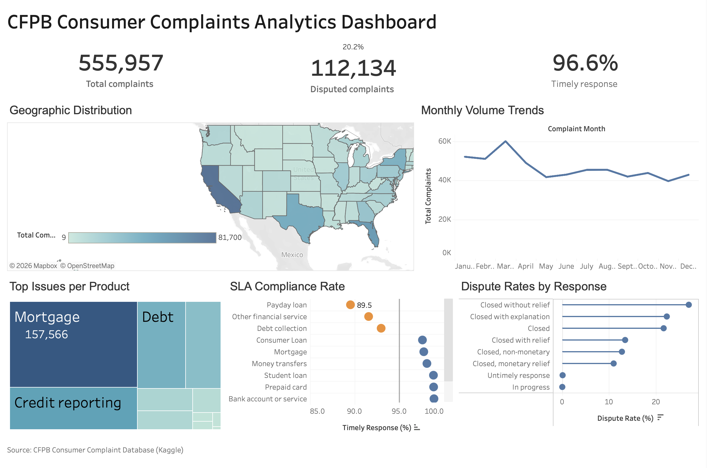

# CFPB Consumer Complaints Analytics Dashboard

## 📌 Overview
An end-to-end data analytics project analyzing **555,957 consumer complaints** filed with the Consumer Financial Protection Bureau (CFPB). Using **SQLite** for data auditing, cleaning, and exploration, and **Tableau** for visualization, this project delivers an interactive dashboard designed to help stakeholders monitor complaint volumes, track SLA compliance, and identify high-risk financial products.

**Tools Used:** SQLite, Tableau

---

## 🎯 Business Questions
This project answers the following critical questions for operational and compliance teams:
- **Geographic Distribution:** Which states generate the highest volume of complaints?
- **Monthly Trends:** How does complaint volume fluctuate throughout the year?
- **Product Issues:** What are the top issues reported for specific financial products?
- **SLA Compliance:** Are companies responding to complaints within a timely manner?
- **Dispute Rates:** How do dispute rates vary based on the company's response type?

---

## 📊 Dashboard Preview



---

## 🔍 Key Insights from the Data
Based on the analysis of 555,957 records:
- **Volume & Resolution:** While the dataset contains over 555K total complaints, roughly **20.2% (112,134)** were officially disputed. 
- **SLA Performance:** The overall timely response rate is highly successful at **96.6%**. However, certain products (like "Payday loan" and "Other financial service") show lower SLA compliance compared to standard banking products.
- **Top Products & Issues:** **Mortgage** (157,566 complaints) is the most complained-about products. Credit reporting remains a massive driver of volume.
- **Dispute Rates:** Complaints closed "without relief" have the highest dispute rate, whereas those closed with "monetary relief" see lower dispute rates.

---

## 🗂️ Project Structure

```
├── data/
│   └── consumer_complaints.sqlite
├── sql/
│   ├── 01_data_audit.sql            # Data profiling and quality checks
│   ├── 02_top_issues.sql          
│   └── 03_timeliness_sla.sql
│   └── 04_state_distribution.sql
│   └── 05_monthly_trends.sql    
├── tableau/
│   └── cfpb_dashboard.twbx          # Tableau workbook
├── images/
│   └── dashboard-preview.png        # Dashboard screenshot
└── README.md
```

## 📁 Dataset
- **Source:** [CFPB Consumer Complaint Database on Kaggle](https://www.kaggle.com/datasets/kaggle/us-consumer-finance-complaints)
- **Original Provider:** Kaggle
- **Size:** 555,957 rows
- **Note on Data:** The full dataset exceeds GitHub's file size limits. A small sample is included in the `/data` folder. To run the full analysis, download the original dataset from the Kaggle link above.

## 👤 About Me
John Nico S. Castro — Aspiring Data Analyst

- **LinkedIn:** https://www.linkedin.com/in/john-nico-castro/
- **Tableau Public:** https://public.tableau.com/app/profile/john.nico.castro/vizzes
- **GitHub:** https://github.com/nicocastro05
